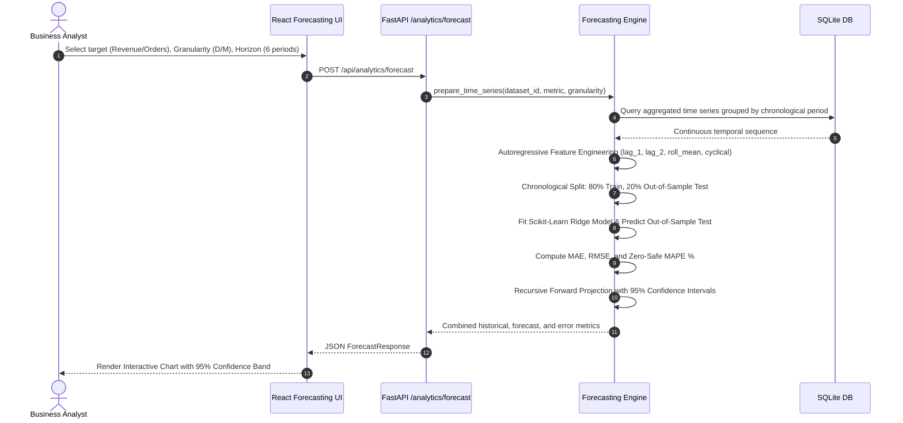
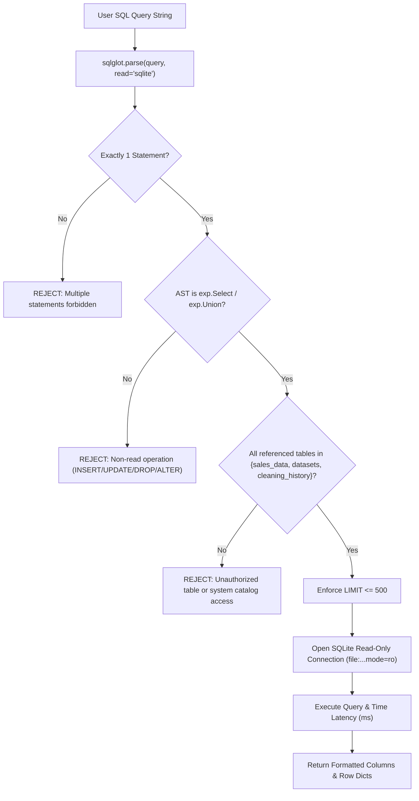

# InsightIQ — System Architecture & Data Engineering

This document outlines the end-to-end architectural design, data pipelines, model evaluation strategies, and security isolation layers powering the **InsightIQ Business Intelligence & Predictive Analytics Platform**.

---

## 1. High-Level System Architecture

InsightIQ adopts a decoupled, modern client-server architecture with strict separation between user-facing presentation, statistical processing, machine learning modeling, and persistent storage.

```mermaid
flowchart TD
    subgraph Client ["Frontend Layer (React 18 + Vite + TypeScript)"]
        UI["Tailwind CSS + Lucide Icons"]
        Router["React Router v6"]
        Recharts["Interactive Recharts Visualizations"]
        APIService["Typed REST API Client (Axios/Fetch)"]
    end

    subgraph Server ["Backend API Layer (FastAPI + Python 3)"]
        FastAPIApp["FastAPI REST Application"]
        CORS["CORS & Request Validation Middleware"]
        PydanticSchemas["Pydantic Models & Data Contracts"]
    end

    subgraph AnalyticsEngines ["Analytical & ML Processing Engines"]
        KPIEngine["KPI & Growth Calculation Engine"]
        CleaningEngine["Data Profiler & Quality Scorer"]
        EDAEngine["Statistical EDA & Distribution Analyzer"]
        ForecastEngine["Ridge ML & EWMA Time Series Engine"]
        SegmentEngine["RFM Quintiles & K-Means Clustering"]
        InsightEngine["Deterministic Rule-Based Insight Engine"]
        SQLLabEngine["sqlglot AST Validator & Query Runner"]
        ReportEngine["ReportLab Executive PDF & CSV Generator"]
    end

    subgraph DataStore ["Persistence & Storage Layer"]
        SQLiteDB[("SQLite Database (insightiq.db)")]
        Tables["sales_data | datasets | cleaning_history"]
        RawCSVStorage["Data Catalog / Local CSV Files"]
    end

    UI --> Router
    Router --> APIService
    APIService -->|HTTP / JSON| FastAPIApp
    FastAPIApp --> CORS
    CORS --> PydanticSchemas
    PydanticSchemas --> AnalyticsEngines
    AnalyticsEngines -->|Read/Write Connection| SQLiteDB
    AnalyticsEngines -->|Strict Read-Only URI (?mode=ro)| SQLiteDB
    AnalyticsEngines --> RawCSVStorage
    AnalyticsEngines -->|Aggregated Payloads| FastAPIApp
    FastAPIApp -->|Validated Response| APIService
    APIService --> Recharts
```

---

## 2. Data Ingestion & Cleaning Pipeline

The ingestion pipeline sanitizes arbitrary uploads, prevents formula injection, profiles quality dimensions, and guarantees schema conformance.


---

## 3. Predictive Forecasting Architecture

The forecasting subsystem enforces zero data leakage by employing time-ordered train/test validation without future period contamination.



---

## 4. SQL Analytics Lab AST Security Architecture

Security is achieved by Abstract Syntax Tree (AST) inspection via `sqlglot` rather than naive regex or keyword blacklists.



---

## 5. Database Relational Schema

### `datasets` Table
| Column Name | Type | Key | Description |
|---|---|---|---|
| `id` | TEXT | PRIMARY KEY | Unique dataset identifier (e.g. `sample_superstore`, `ds_1718000000`) |
| `name` | TEXT | | Display title for the dataset |
| `description` | TEXT | | Analytical scope and notes |
| `row_count` | INTEGER | | Total valid rows ingested |
| `column_count`| INTEGER | | Total columns |
| `is_sample` | BOOLEAN | | `1` for default seed, `0` for user uploads |
| `created_at` | TIMESTAMP | | Record registration timestamp |
| `file_path` | TEXT | | Local disk CSV backing store path |

### `sales_data` Table
| Column Name | Type | Constraints | Description |
|---|---|---|---|
| `id` | INTEGER | PRIMARY KEY AUTOINCREMENT | Surrogate transactional line key |
| `dataset_id` | TEXT | FOREIGN KEY REFERENCES datasets(id) | Relational tenant isolation |
| `order_id` | TEXT | NOT NULL | Business order number |
| `order_date` | TEXT | NOT NULL (ISO YYYY-MM-DD) | Chronological order timestamp |
| `customer_id`| TEXT | NOT NULL | Customer account identifier |
| `customer_name`| TEXT | | Customer full name |
| `segment` | TEXT | | Consumer / Corporate / Home Office |
| `region` | TEXT | | Geographic region (North, South, East, West, Central) |
| `country` | TEXT | | Nation (default 'United States') |
| `city` | TEXT | | City municipality |
| `state` | TEXT | | State / Province |
| `category` | TEXT | | Technology, Furniture, Office Supplies |
| `sub_category`| TEXT | | Phones, Chairs, Storage, etc. |
| `product_id` | TEXT | | Catalog SKU / Product code |
| `product_name`| TEXT | | Product title |
| `quantity` | INTEGER | NOT NULL (>= 1) | Unit count |
| `unit_price` | REAL | NOT NULL (> 0) | Retail list price |
| `discount` | REAL | DEFAULT 0.0 (0.0 to 0.9) | Promotional discount percentage |
| `shipping_cost`| REAL | DEFAULT 0.0 | Freight / shipping fulfillment charge |
| `revenue` | REAL | NOT NULL | Net line item sales: `qty * price * (1 - discount)` |
| `cost` | REAL | NOT NULL | Cost of Goods Sold (COGS) |
| `profit` | REAL | NOT NULL | Net margin: `revenue - cost - shipping_cost` |

### `cleaning_history` Table
| Column Name | Type | Description |
|---|---|---|
| `id` | INTEGER | Primary key |
| `dataset_id` | TEXT | Dataset reference |
| `cleaned_at` | TIMESTAMP | Processing execution timestamp |
| `rows_before` | INTEGER | Raw row count before deduplication / cleaning |
| `rows_after` | INTEGER | Valid row count ingested |
| `duplicates_removed`| INTEGER | Count of identical rows purged |
| `nulls_handled` | INTEGER | Missing cells imputed or dropped |
| `quality_score_before`| REAL | Score prior to cleaning (0-100) |
| `quality_score_after` | REAL | Score following cleaning (0-100) |
| `cleaning_log`| TEXT | Summary of operations applied |
